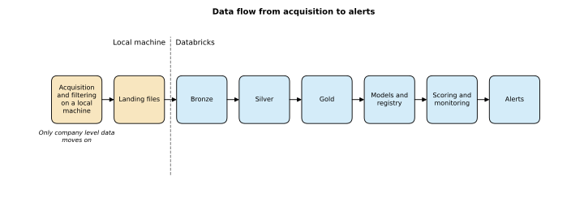
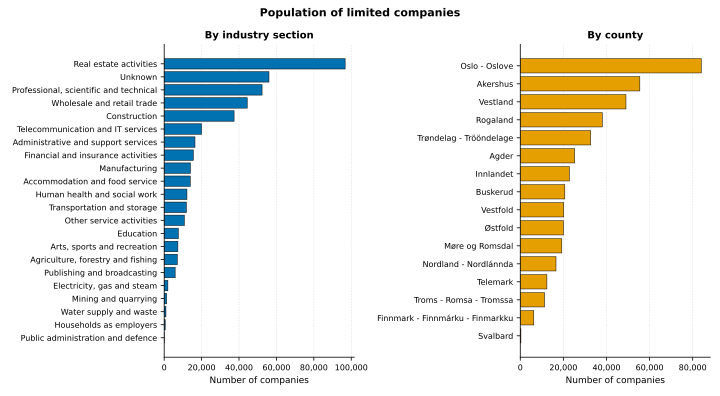
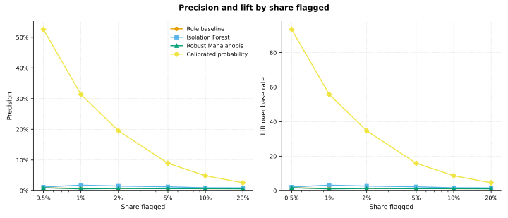
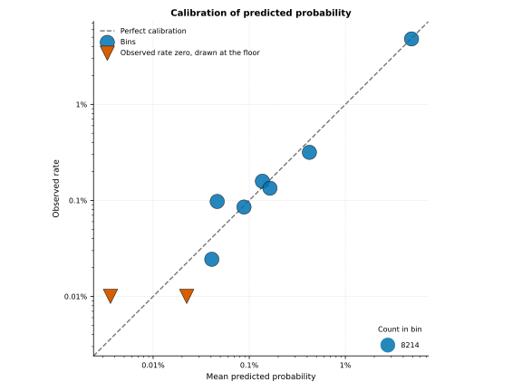
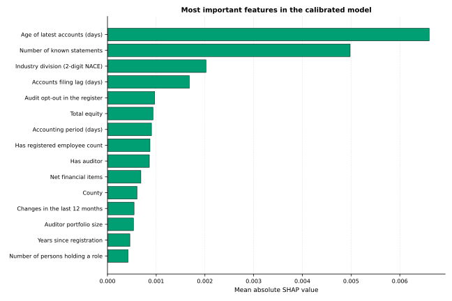
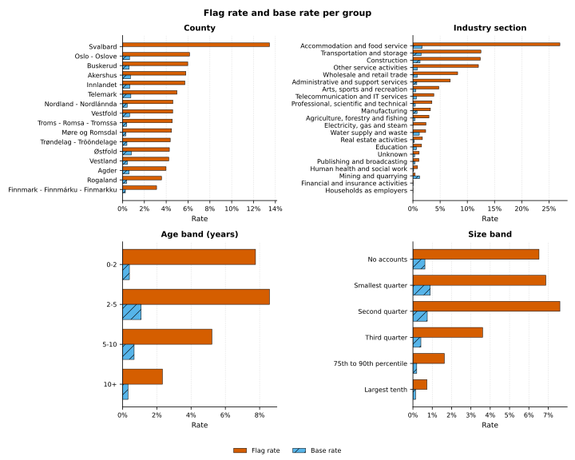

# foretaksrisiko

**Interactive demo:** [foretaksrisiko.azurewebsites.net](https://foretaksrisiko.azurewebsites.net). Build a made-up company and see what the models say about it.

Statistically unusual patterns among Norwegian limited companies (AS and ASA), built on open data from the Brønnøysund Register Centre. The project is made for research and demonstration. It shows what open register data can and cannot say about unusual companies, and it shows a full model lifecycle on a lakehouse platform. A high score means "unusual compared with similar companies" or "higher probability of a registered outcome". It never means that a company did anything wrong. The project publishes no results for single companies.

[Norsk versjon](README.md)

## What the project does

The project fetches the full register files from Enhetsregisteret, the change feeds, key figures from Regnskapsregisteret and code lists from Statistics Norway. The filters are strict: only AS and ASA, no voluntary organisations, no personal data.

The data goes into a lakehouse with three layers, built with PySpark, Spark SQL and Delta Lake on Databricks. Every layer has quality checks, and a history table covers all snapshots. The features are computed there at company level: register, roles as counts, networks between organisations, accounts, scores relative to the peer group, and text similarity between the stated purpose and the industry code.

The models are three anomaly scores trained without labels and one calibrated probability of a registered outcome. Everything is measured against a plan written in advance, with confidence intervals, ablations and a fairness analysis.

The model is also followed up after training. The project has experiment tracking in MLflow and a model registry in Unity Catalog with `champion` and `challenger` aliases. It has a promotion rule with manual approval and a scheduled job per snapshot. It also has drift monitoring, alerts, and rules for retraining and rollback.

## Results in brief

The champion model is trained on the whole population in snapshot 1. The test split holds about 82,000 companies and 462 registered outcomes.

| Metric on the test split, calibrated probability | Value |
|---|---|
| Area under the precision-recall curve | 0.47 (0.42 to 0.51) |
| Precision among the top 1 percent | 0.32, against a base rate of 0.56 percent |
| Lift among the top 1 percent | 57 |
| Brier score | 0.0038 |

The accounts features carry most of the signal. Without them the area under the precision-recall curve falls from 0.47 to 0.15. The anomaly scores trained without labels sit only just above the base rate, and the link between "unusual" and "likely outcome" is weak. Both findings are documented in `docs/modellkort.md` and `docs/valideringsrapport.md`.

## Figures













More figures live in `figures/`: ablations, the score distributions, drift across snapshots and the distribution of auditor portfolio sizes. Every figure is built by a script from the group-level files in `demo_data/`, in a Norwegian and an English version.

## Architecture

| Part | Content |
|---|---|
| `src/foretaksrisiko/acquire` | Local acquisition with filtering, polite API use and a manifest per snapshot |
| `src/foretaksrisiko/lakehouse` | Bronze, silver and gold, outcomes, labels and features in PySpark and Spark SQL |
| `src/foretaksrisiko/quality` | Quality checks per layer, written to a monitoring table |
| `src/foretaksrisiko/models` | Anomaly scores, calibrated classifier, training and scoring on the lakehouse |
| `src/foretaksrisiko/evaluation` | Metrics with bootstrap, stability, explanations and fairness |
| `src/foretaksrisiko/registry` | Model registry, promotion rule, rollback and event log |
| `src/foretaksrisiko/monitoring` | Drift, score summary, alerts and retraining rules |
| `src/foretaksrisiko/figures` | Export of group-level demo data, and the figures |
| `src/foretaksrisiko/demo` | Model files for the demo and the scoring of a made-up company |
| `app/` | The Streamlit demo, with `Dockerfile` and `infra/main.bicep` for Azure |
| `databricks.yml` | Asset Bundle with the jobs `snapshot_pipeline` and `train_challenger` |
| `configs/default.yaml` | All thresholds, sample sizes and paths |
| `tests/` | Tests on synthetic data, including the privacy rules |
| `scripts/` | Style scan, privacy scan and helper scripts |

## Documentation

All documents are in Norwegian.

| Document | Content |
|---|---|
| [Method](docs/metode.md) | Pipeline, features, labels, models and evaluation |
| [Data sources](docs/datakilder.md) | Sources, licences, fields used and what is filtered out |
| [Privacy](docs/personvern.md) | How personal data is kept out, and what is published |
| [Model card](docs/modellkort.md) | Purpose, use, data, performance and limitations |
| [Validation report](docs/valideringsrapport.md) | Plan written in advance, and results against the plan |
| [Fairness](docs/rettferdighet.md) | Flag rate and precision per group, and the countermeasure that was tried |
| [Model lifecycle](docs/modellivssyklus.md) | Registry, promotion, rollback, scheduled job, monitoring and retraining rules |

## Running the project

The project uses Python 3.12 and `uv`. Spark runs locally in the tests and on Databricks in operation.

```bash
uv sync --all-extras
```

Acquire one snapshot locally, with every filter applied:

```bash
uv run foretaksrisiko acquire all --snapshot 1
```

The next snapshot copies the sample, fetches only the change events since the previous one and carries accounts forward:

```bash
uv run foretaksrisiko acquire all --snapshot 2 --previous 1
```

Upload the landing files and run the job on Databricks:

```bash
uv run foretaksrisiko lakehouse upload --snapshot 2
```

```bash
databricks bundle deploy -t dev
```

```bash
databricks bundle run -t dev snapshot_pipeline --params snapshot_id=2
```

Train a challenger, evaluate it against the promotion rule and promote it with approval:

```bash
databricks bundle run -t dev train_challenger --params snapshot_id=1,scope=population
```

```bash
uv run foretaksrisiko registry evaluate 2 --profile foretaksrisiko
```

```bash
uv run foretaksrisiko registry promote 2 --approve --profile foretaksrisiko
```

Export the group-level demo data and render the figures:

```bash
uv run foretaksrisiko figures export --profile foretaksrisiko
```

```bash
uv run foretaksrisiko figures render
```

## Demo

The demo is a Streamlit app with six pages: overview, try it yourself, patterns in the register, the model, monitoring, and privacy and method. It uses only the group-level files in `demo_data/`, the figures in `figures/` and the model files in `demo_data/model/`. Nothing is looked up in the registers, and no real company can be looked up. On the "Try it yourself" page you put together a made-up company with sliders and dropdowns. The page shows the probability, the anomaly score, the position within the peer group and what drives the score.

Export the model files from the lakehouse. The files hold the champion, robust parameters and group statistics, never training rows:

```bash
uv run foretaksrisiko demo export --profile foretaksrisiko
```

Run the demo locally:

```bash
uv run streamlit run app/streamlit_app.py
```

Build and run the container:

```bash
docker build -t foretaksrisiko-demo .
```

```bash
docker run --rm -p 8000:8000 foretaksrisiko-demo
```

The demo can run on Azure App Service (Linux) from the container. `infra/main.bicep` describes an app on the cheapest plan that works. The packages the app needs are pinned in `app/requirements.txt`.

## Tests and checks

```bash
uv run pytest
```

```bash
uv run python scripts/style_scan.py
```

```bash
uv run python scripts/privacy_scan.py
```

The tests use synthetic data only, with organisation numbers that fail the checksum. The style scan fails on dashes used as punctuation and on words that would give the scores a meaning other than "unusual". The privacy scan fails on valid organisation numbers, person field names and calendar dates in public files.

## Privacy

Personal data exists only in memory, at the moment the role data is read. It is turned into counts per company at once. No personal data is written to disk, uploaded or published. All public material shows figures only for groups of at least 20 companies. The details are in [docs/personvern.md](docs/personvern.md).

## Data sources and licence

Contains data under the Norwegian Licence for Open Government Data (NLOD) 2.0, made available by the Brønnøysund Register Centre, and code lists from Statistics Norway under Creative Commons Attribution 4.0 International (CC BY 4.0). Neither source has approved or is responsible for the content of this project. See [DATA_NOTICE.md](DATA_NOTICE.md).

The code is licensed under MIT, see [LICENSE](LICENSE).
