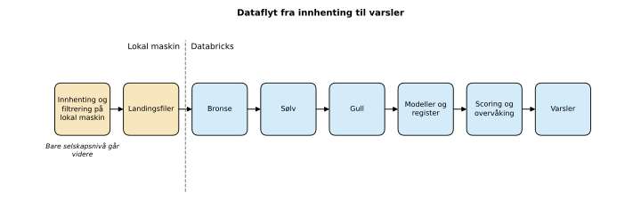
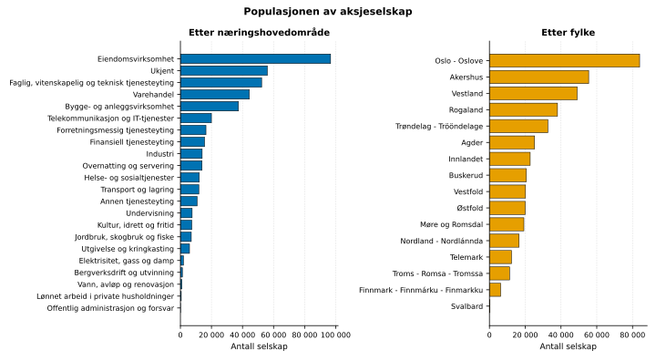
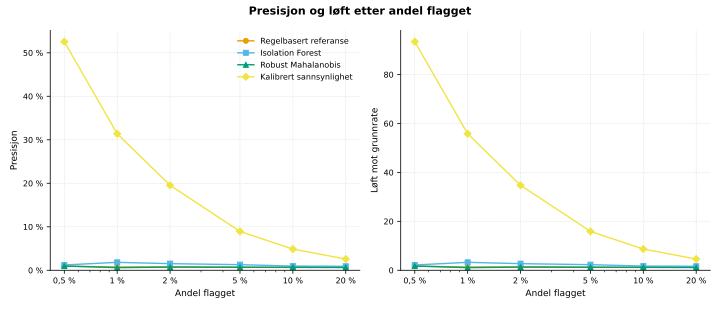
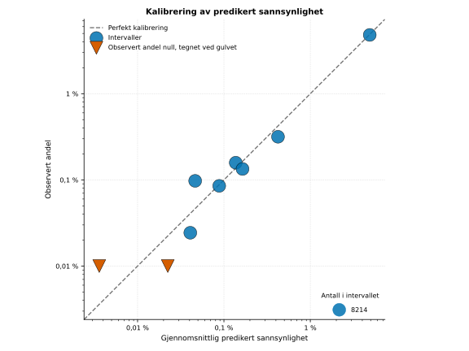
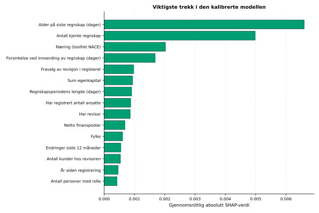
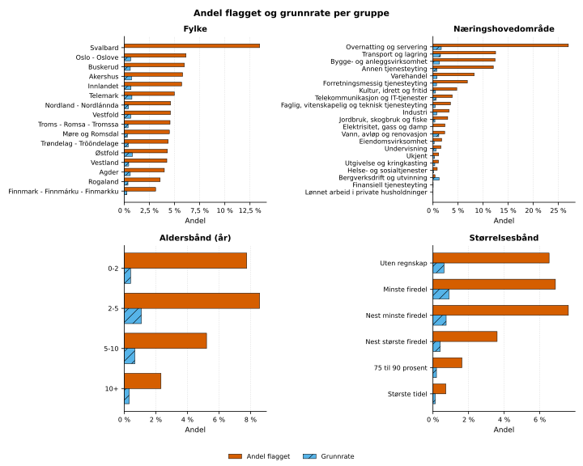

# foretaksrisiko

**Interaktiv demo:** [foretaksrisiko.azurewebsites.net](https://foretaksrisiko.azurewebsites.net). Sett sammen et oppdiktet selskap og se hva modellene sier om det.

Statistisk uvanlige mønstre blant norske aksjeselskap (AS og ASA), bygget på åpne data fra Brønnøysundregistrene. Prosjektet er laget for forskning og demonstrasjon. Det viser hva åpne registerdata kan og ikke kan si om uvanlige selskap, og det viser en hel modellivssyklus på en lakehouse-plattform. En høy skår betyr «uvanlig sammenlignet med lignende selskap» eller «høyere sannsynlighet for et registrert utfall». Den betyr aldri at et selskap har gjort noe galt. Prosjektet publiserer ingen resultater for enkeltselskap.

[English version](README.en.md)

## Hva prosjektet gjør

Prosjektet henter hele bestanden fra Enhetsregisteret, endringshendelser, nøkkeltall fra Regnskapsregisteret og kodelister fra SSB. Filtrene er strenge: bare AS og ASA, ingen frivillige organisasjoner, ingen personopplysninger.

Dataene går inn i et lakehouse med tre lag, bygget i PySpark, Spark SQL og Delta Lake på Databricks. Hvert lag har kvalitetskontroller, og en historikktabell dekker alle øyeblikksbilder. Der regnes trekkene ut på selskapsnivå: register, roller som tall, nettverk mellom organisasjoner, regnskap, relative skårer, og likhet mellom formålstekst og næringskode.

Modellene er tre avviksskårer uten merkelapper og én kalibrert sannsynlighet for et registrert utfall. Alt måles mot en plan som ble skrevet på forhånd, med konfidensintervall, ablasjoner og analyse av rettferdighet.

Modellen følges også opp etter treningen. Prosjektet har eksperimentlogg i MLflow og modellregister i Unity Catalog med `champion` og `challenger`. Det har en regel for forfremmelse med manuell godkjenning og en planlagt jobb per øyeblikksbilde. Det har også overvåking av drift, varsler, og regler for ny trening og tilbakerulling.

## Resultater i korte trekk

Hovedmodellen er trent på hele populasjonen i øyeblikksbilde 1. Testdelen har omtrent 82 000 selskap og 462 registrerte utfall.

| Mål på testdelen, kalibrert sannsynlighet | Verdi |
|---|---|
| Areal under presisjon-gjenkallingskurven | 0,47 (0,42 til 0,51) |
| Presisjon blant de 1 prosent høyest rangerte | 0,32, mot en grunnrate på 0,56 prosent |
| Løft blant de 1 prosent høyest rangerte | 57 |
| Brier-skår | 0,0038 |

Regnskapstrekkene bærer det meste av signalet. Uten dem faller arealet under presisjon-gjenkallingskurven fra 0,47 til 0,15. Avviksskårene uten merkelapper ligger bare så vidt over grunnraten, og sammenhengen mellom «uvanlig» og «sannsynlig utfall» er svak. Begge funnene står i `docs/modellkort.md` og `docs/valideringsrapport.md`.

## Figurer













Flere figurer ligger i `figures/`: ablasjoner, fordelingen av skårene, drift over øyeblikksbilder, og fordelingen av hvor mange kunder revisorene har. Alle figurer bygges av et skript fra filene med gruppetall i `demo_data/`, i norsk og engelsk utgave.

## Arkitektur

| Del | Innhold |
|---|---|
| `src/foretaksrisiko/acquire` | Lokal innhenting med filtrering, høflig bruk av API-ene og manifest per øyeblikksbilde |
| `src/foretaksrisiko/lakehouse` | Bronse, sølv og gull, utfall, merkelapper og trekk i PySpark og Spark SQL |
| `src/foretaksrisiko/quality` | Kvalitetskontroller per lag, skrevet til en tabell for overvåking |
| `src/foretaksrisiko/models` | Avviksskårer, kalibrert klassifikator, trening og skåring på lakehouset |
| `src/foretaksrisiko/evaluation` | Mål med bootstrap, stabilitet, forklaringer og rettferdighet |
| `src/foretaksrisiko/registry` | Modellregister, regel for forfremmelse, tilbakerulling og logg over hendelser |
| `src/foretaksrisiko/monitoring` | Drift, oppsummering av skårer, varsler og regler for ny trening |
| `src/foretaksrisiko/figures` | Eksport av demodata med gruppetall, og figurene |
| `src/foretaksrisiko/demo` | Modellfiler for demoen og skåring av et oppdiktet selskap |
| `app/` | Streamlit-demoen, med `Dockerfile` og `infra/main.bicep` for Azure |
| `databricks.yml` | Asset Bundle med jobbene `snapshot_pipeline` og `train_challenger` |
| `configs/default.yaml` | Alle terskler, utvalgsstørrelser og stier |
| `tests/` | Tester på syntetiske data, også for reglene om personvern |
| `scripts/` | Stilskanning, personvernskanning og hjelpeskript |

## Dokumentasjon

| Dokument | Innhold |
|---|---|
| [Metode](docs/metode.md) | Pipeline, trekk, merkelapper, modeller og evaluering |
| [Datakilder](docs/datakilder.md) | Kilder, lisenser, felt som brukes, og hva som filtreres bort |
| [Personvern](docs/personvern.md) | Hvordan personopplysninger holdes utenfor, og hva som publiseres |
| [Modellkort](docs/modellkort.md) | Formål, bruk, data, ytelse og begrensninger |
| [Valideringsrapport](docs/valideringsrapport.md) | Plan skrevet på forhånd, og resultater mot planen |
| [Rettferdighet](docs/rettferdighet.md) | Andel flagget og presisjon per gruppe, og mottiltaket som ble prøvd |
| [Modellivssyklus](docs/modellivssyklus.md) | Register, forfremmelse, tilbakerulling, planlagt jobb, overvåking og regler for ny trening |

## Kjøre prosjektet

Prosjektet bruker Python 3.12 og `uv`. Spark kjører lokalt i testene og på Databricks i drift.

```bash
uv sync --all-extras
```

Hente et øyeblikksbilde lokalt, med alle filtre:

```bash
uv run foretaksrisiko acquire all --snapshot 1
```

Neste øyeblikksbilde kopierer utvalget, henter bare endringene siden sist, og kopierer regnskap fra forrige øyeblikksbilde:

```bash
uv run foretaksrisiko acquire all --snapshot 2 --previous 1
```

Laste opp landingsfilene og kjøre jobben på Databricks:

```bash
uv run foretaksrisiko lakehouse upload --snapshot 2
```

```bash
databricks bundle deploy -t dev
```

```bash
databricks bundle run -t dev snapshot_pipeline --params snapshot_id=2
```

Trene en utfordrer, vurdere den mot regelen for forfremmelse, og forfremme den med godkjenning:

```bash
databricks bundle run -t dev train_challenger --params snapshot_id=1,scope=population
```

```bash
uv run foretaksrisiko registry evaluate 2 --profile foretaksrisiko
```

```bash
uv run foretaksrisiko registry promote 2 --approve --profile foretaksrisiko
```

Eksportere demodata med gruppetall og lage figurene:

```bash
uv run foretaksrisiko figures export --profile foretaksrisiko
```

```bash
uv run foretaksrisiko figures render
```

## Demo

Demoen er en Streamlit-app med seks sider: oversikt, prøv selv, mønstre i registeret, modellen, overvåking, og personvern og metode. Den bruker bare filene med gruppetall i `demo_data/`, figurene i `figures/` og modellfilene i `demo_data/model/`. Ingen oppslag gjøres mot registrene, og ingen virkelige selskap kan slås opp. På siden «Prøv selv» setter du sammen et oppdiktet selskap med glidebrytere og nedtrekkslister. Siden viser sannsynligheten, avviksskåren, plasseringen i sammenligningsgruppen og hva som driver skåren.

Eksportere modellfilene fra lakehouset. Filene inneholder hovedmodellen, robuste parametere og gruppetall, aldri treningsrader:

```bash
uv run foretaksrisiko demo export --profile foretaksrisiko
```

Kjøre demoen lokalt:

```bash
uv run streamlit run app/streamlit_app.py
```

Bygge og kjøre containeren:

```bash
docker build -t foretaksrisiko-demo .
```

```bash
docker run --rm -p 8000:8000 foretaksrisiko-demo
```

Demoen kan kjøre på Azure App Service (Linux) fra containeren. `infra/main.bicep` beskriver en app på den rimeligste planen som fungerer. Pakkene appen trenger, er låst i `app/requirements.txt`.

## Tester og kontroller

```bash
uv run pytest
```

```bash
uv run python scripts/style_scan.py
```

```bash
uv run python scripts/privacy_scan.py
```

Testene bruker bare syntetiske data, med organisasjonsnumre som har feil kontrollsiffer. Stilskanningen feiler på tankestreker og på ord som ville gitt skårene en annen mening enn «uvanlig». Personvernskanningen feiler på gyldige organisasjonsnumre, feltnavn for personopplysninger og kalenderdatoer i offentlige filer.

## Personvern

Personopplysninger finnes bare i minnet, i det øyeblikket rolledataene leses. De gjøres straks om til tall per selskap. Ingen personopplysninger skrives til disk, lastes opp eller publiseres. Alt offentlig materiale viser bare tall for grupper på minst 20 selskap. Detaljene står i [docs/personvern.md](docs/personvern.md).

## Datakilder og lisens

Inneholder data under Norsk lisens for offentlige data (NLOD) 2.0, tilgjengeliggjort av Brønnøysundregistrene, og kodelister fra Statistisk sentralbyrå under Creative Commons Navngivelse 4.0 Internasjonal (CC BY 4.0). Ingen av kildene har godkjent eller står bak innholdet i prosjektet. Se [DATA_NOTICE.md](DATA_NOTICE.md).

Koden er lisensiert under MIT, se [LICENSE](LICENSE).
